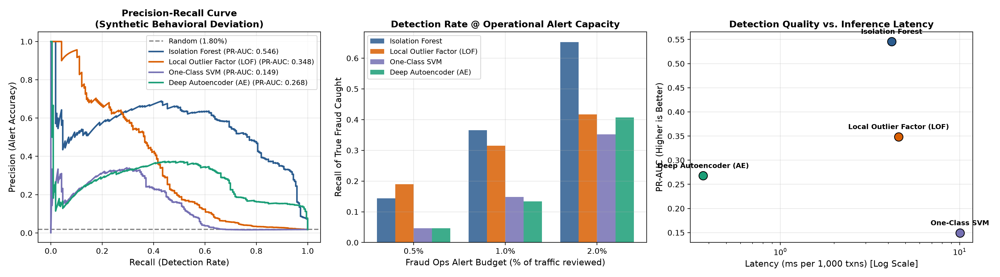
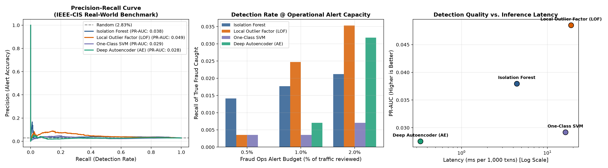

# Behavioral Anomaly Detection for Fraud Detection

[](https://opensource.org/licenses/MIT)
[](https://www.python.org/downloads/)
[](https://pytorch.org/)
[](https://scikit-learn.org/)

An empirical benchmarking suite evaluating four unsupervised anomaly detection paradigms (**Isolation Forest**, **Local Outlier Factor**, **One-Class SVM**, and a **Deep Tabular Autoencoder**) on behavioral deviation patterns in fraud detection.

---

## 📌 Motivation & Problem Formulation

Standard transaction-level fraud detection evaluates each transaction in isolation (amount, merchant, timestamp). In contrast, **behavioral deviation detection** frames fraud as a divergence from an entity's established historical baseline:

* **Account Takeover (ATO):** Sudden spikes in geographical travel velocity, uncharacteristic active hours, and rapid device switching.
* **Card Testing / Bot Swarms:** Abnormal velocity surges of micro-transactions on digital merchants.
* **Bust-out Fraud:** Progressive spending escalation exceeding historical limits.

This repository systematically benchmarks four algorithmic families across two distinct environments:
1. **Synthetic Multi-Cohort Behavioral Dataset:** Controlled simulation isolating behavioral deviation mechanics.
2. **IEEE-CIS Real-World Fraud Dataset:** Real-world e-commerce stream featuring entity velocity surges (`C`), timedelta recencies (`D`), and spending deviations.

---

## 📊 Empirical Benchmark Results

### 1. Synthetic Behavioral Benchmark (30,000 txns, 1.8% base fraud rate)

| Model | PR-AUC | ROC-AUC | Recall @ 0.5% Alert | Recall @ 1.0% Alert | Recall @ 2.0% Alert | Latency (ms / 1k txns) |
| :--- | :---: | :---: | :---: | :---: | :---: | :---: |
| **Isolation Forest** | **0.5458** | **0.9840** | 14.35% | **36.57%** | **65.28%** | 4.2 ms |
| **Local Outlier Factor (LOF)** | 0.3485 | 0.8180 | **18.98%** | 31.48% | 41.67% | 4.6 ms |
| **Deep Autoencoder (AE)** | 0.2679 | 0.9651 | 4.63% | 13.43% | 40.74% | **0.4 ms** |
| **One-Class SVM** | 0.1494 | 0.6618 | 4.63% | 14.81% | 35.19% | 10.0 ms |



---

### 2. IEEE-CIS Real-World Benchmark (25,000 txns, 31 features, 2.83% fraud)

| Model | PR-AUC | ROC-AUC | Recall @ 0.5% Alert | Recall @ 1.0% Alert | Recall @ 2.0% Alert | Latency (ms / 1k txns) |
| :--- | :---: | :---: | :---: | :---: | :---: | :---: |
| **Local Outlier Factor (LOF)** | **0.0485** | **0.6209** | 0.35% | **2.47%** | **3.53%** | 18.9 ms |
| **Isolation Forest** | 0.0380 | 0.6099 | **1.41%** | 1.77% | 2.12% | **4.4 ms** |
| **One-Class SVM** | 0.0292 | 0.4688 | 0.35% | 0.35% | 0.71% | 16.2 ms |
| **Deep Autoencoder (AE)** | 0.0276 | 0.4857 | 0.00% | 0.71% | 3.18% | **0.3 ms** |



---

## 🔍 Key Findings & Takeaways

1. **Isolation Forest is the strongest unsupervised screener:**
   * Achieved **0.546 PR-AUC** on behavioral features and caught **65.3% of true fraud within a 2.0% operational alert budget**.
2. **The "Real-World Gap" in Fraud Anomaly Detection:**
   * In messy real-world transaction streams (IEEE-CIS), pure unsupervised models face steep degradation. Legitimate users exhibit high behavioral variance (holiday shopping, VIP spending, international travel), while fraudsters actively camouflage attacks to mimic normal distributions.
   * **Recommendation:** Use Isolation Forest and Autoencoder scores as **enrichment features** feeding into a downstream supervised gradient-boosted tree (e.g., LightGBM / XGBoost) rather than a standalone binary gate.
3. **Autoencoder Feature Attribution (Explainability):**
   * The Deep Autoencoder allows decomposing the reconstruction error per feature, exposing root-cause explanations for fraud operations:
     * **ATO:** Driven **89.4%** by `travel_speed_kmh`.
     * **Bust-out:** Driven **40.6%** by `amount_zscore` and **39.1%** by `amount_ratio_to_median`.
     * **Card Testing:** Distributed across velocity surges and micro-amount anomalies.
   * Delivers the lowest inference latency (**0.3–0.4 ms / 1k samples**).

---

## 📁 Repository Structure

```
behavioral_anomaly_detection/
├── data/
│   ├── synthetic_generator.py      # Simulates user cohorts, legitimate noise & 3 fraud archetypes
│   └── ieee_cis_loader.py          # Streams, caches, and engineers IEEE-CIS behavioral features
├── models/
│   ├── base.py                     # Uniform anomaly scoring interface (higher = higher risk)
│   ├── isolation_forest.py         # Isolation Forest wrapper
│   ├── local_outlier_factor.py     # Local Outlier Factor (novelty=True)
│   ├── one_class_svm.py            # One-Class SVM with RobustScaler
│   └── autoencoder.py              # PyTorch Deep Tabular Autoencoder + error attribution
├── results/
│   ├── benchmark_summary.json      # Machine-readable evaluation metrics
│   ├── synthetic_benchmark.png     # Evaluation curves for synthetic experiment
│   └── ieee_cis_benchmark.png      # Evaluation curves for IEEE-CIS experiment
├── evaluator.py                    # PR-AUC, Recall@k%, Precision@k%, Latency profiler
├── run_experiments.py              # Master benchmark runner
├── pyproject.toml                  # Modern package metadata
├── requirements.txt                # Pip requirements
└── LICENSE                         # MIT License
```

---

## 🚀 Quickstart

### Prerequisites
* Python 3.10+
* `uv` (recommended) or standard `pip`

### 1. Installation
Clone the repository and set up a virtual environment:
```bash
git clone https://github.com/lawrencekiba/behavioral-anomaly-detection-fraud.git
cd behavioral-anomaly-detection-fraud

# Using uv (fastest)
uv venv
source .venv/bin/activate
uv pip install -r requirements.txt

# Or using standard pip
python3 -m venv .venv
source .venv/bin/activate
pip install -r requirements.txt
```

### 2. Run the Benchmark
Run the complete benchmark across both datasets:
```bash
python run_experiments.py
```
* Note: The IEEE-CIS loader streams a lightweight sample directly on first run and caches it locally under `data/cache/` for instant subsequent executions.

---

## 📜 License
Distributed under the MIT License. See [LICENSE](LICENSE) for more information.
